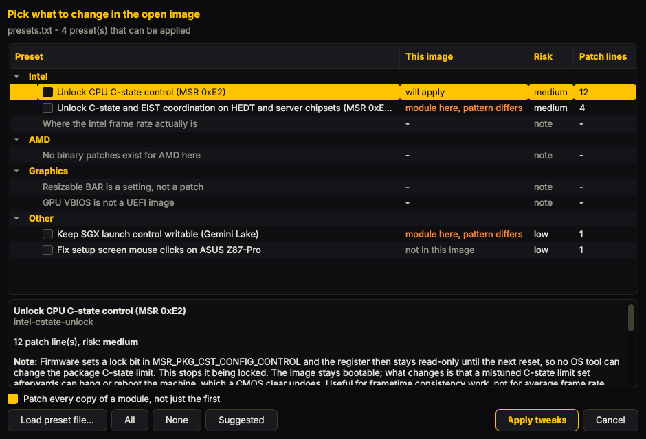
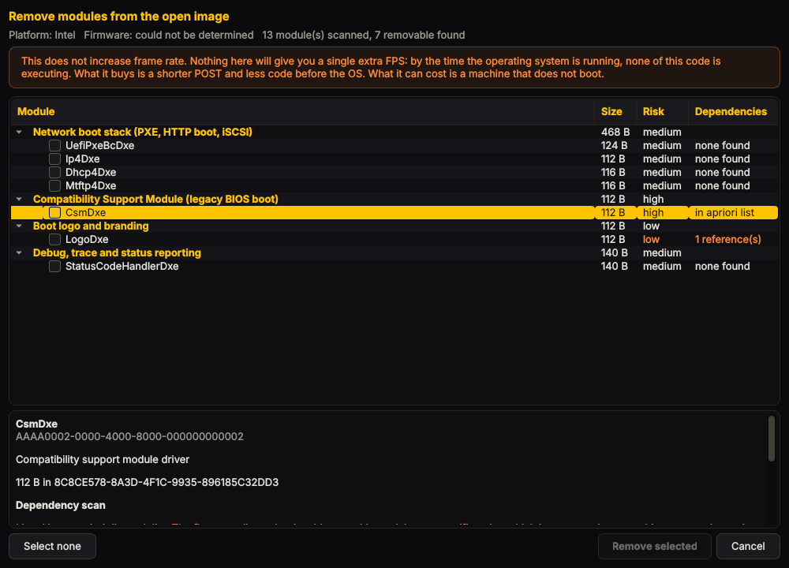

# UEFITool 0.28.0, modified, with a firmware performance toolkit

UEFITool 0.28.0 from [LongSoft/UEFITool](https://github.com/LongSoft/UEFITool)
with a yellow on black GUI and a one-click preset list, a reworked
**UEFIPatch**, a patch database organised into named sets, a helper for
finding your own patch patterns, and documentation on which BIOS changes
actually move frame rate.

Base commit: `d9642c53e7b873fcce858ec2bea577f099b966d5` (tag `0.28.0`).





## Kratko (hrvatski)

- **GUI**: žuto-crna tema sa zaobljenim kutovima i prozirnošću
  (View -> Window opacity, 100-75%), **Tweaks -> Performance presets...**
  (Ctrl+T) i **Tweaks -> Debloat...** (Ctrl+D).
  Detalji: [`docs/gui-guide.md`](docs/gui-guide.md).
- **Scan**: kad otvoriš sliku, program ju pregleda i sam zaključi je li
  **Intel ili AMD** (i koji firmware: AMI/Insyde/Phoenix), pa ti na osnovu
  toga predloži. Preseti dobiju stupac *This image*: `will apply` /
  `module here, pattern differs` / `not in this image`, a gumb **Suggested**
  označi samo ono što stvarno paše tvojoj slici.
- **Debloat** nudi samo module koje je **našao u tvojoj slici**, grupirane po
  kategorijama, i za svaki prije brisanja provjeri ovisnosti (apriori lista +
  tko nosi njegov GUID). ⚠️ Debloat **ne daje FPS** — skraćuje POST i smanjuje
  količinu koda prije OS-a. To piše i u samom dijalogu.
  Detalji: [`docs/scanning-and-debloat.md`](docs/scanning-and-debloat.md).
- Preseti su grupirani po platformi: **Intel** ima dva stvarna preseta
  (otključavanje MSR 0xE2 i 0xE2+0x1AA), **AMD** i **Graphics** nemaju što
  primijeniti i dijalog to pošteno kaže umjesto da nudi gumb koji ne radi
  ništa — objašnjeno u `docs/gui-guide.md`.
- `UEFITool-0.28.0/` je originalni source s izmjenama.
- **Popravljeno 5 pravih bugova u originalu**, uključujući segfault i
  čitanje izvan heapa koje je upisivalo smeće iz memorije u BIOS sliku.
  Detalji i reprodukcija: [`docs/tool-changes.md`](docs/tool-changes.md).
- **Najvažnije novo**: original je mogao reći "Image patched" i vratiti
  exit 0 čak i kad se patch koji ti treba nije primijenio. Sad `-v` pokaže
  svaku liniju kao `[applied]` ili `[ missed]`, a `--strict` vrati grešku.
- Što zapravo daje FPS: [`docs/bios-performance-guide.md`](docs/bios-performance-guide.md).
  Kratko — memorija (XMP/EXPO + timinzi), power limiti (PL1/PL2, Curve
  Optimizer) i Resizable BAR. Patchanje binarnog BIOS-a **nije** na toj
  listi; ono samo otključava registre da bi to troje bilo dostupno.
- **Pročitaj [`docs/risks-and-recovery.md`](docs/risks-and-recovery.md) prije
  flashanja.** Ako ploča ima Intel Boot Guard (većina OEM-a i dosta
  consumer ploča od ~2015.), modificirani BIOS se **neće** bootati i nema
  softverskog zaobilaženja — tada ide ruta preko NVRAM varijabli, bez
  flashanja.

## Build

Needs Qt 4 or Qt 5. Verified here with Qt 5.15.

```sh
cd UEFITool-0.28.0
qmake uefitool.pro && make          # the GUI
```


```sh
cd UEFITool-0.28.0/UEFIPatch
qmake uefipatch.pro && make         # the command line patcher
```

`UEFIReplace` builds the same way and is unchanged.

## Using the GUI

Opening an image scans it: platform (Intel or AMD), firmware vendor, regions,
module inventory and apriori lists, all reported to the Messages list and
again under **Tweaks -> Analyze image**.

**Tweaks -> Performance presets...** (Ctrl+T) applies groups of patches. The
**This image** column says what each preset would do to the file you have
open, and **Suggested** ticks only the ones whose patterns actually match.
Applying gives a per-line report and an offer to rebuild and save; when
nothing matched it says so instead of pretending the image changed.

**Tweaks -> Debloat...** (Ctrl+D) removes modules. Only modules found in your
image are offered, and each one is checked against the apriori lists and
cross referenced against every other module's body before you can tick it.
It does not improve frame rate and says so.

**View** holds the theme toggle and the window opacity setting.

[`docs/gui-guide.md`](docs/gui-guide.md) and
[`docs/scanning-and-debloat.md`](docs/scanning-and-debloat.md) cover both.

## Using the command line tool

```sh
# what is in the patch database
UEFIPatch --list patches/performance.txt

# try the MSR 0xE2 unlocks against a dump, write nothing
UEFIPatch bios.bin patches/performance.txt \
          --set msr-e2-unlock --strict --verbose --dry-run --hash

# do it for real
UEFIPatch bios.bin patches/performance.txt \
          --set msr-e2-unlock --strict --hash -o bios-modded.bin
```

`--dry-run` does everything including reconstructing the image, so a dry run
that succeeds means the real run will. `--strict` is the one you want on for
anything you intend to flash: it turns "some patches applied, the one you
needed did not" from exit 0 into an error.

### Finding patterns for your own board

```sh
UEFIExtract bios.bin
tools/msr-lock-scan.py bios.bin.dump/<module>/.../body.bin
```

The scanner locates every `rdmsr`/`wrmsr`, attributes it to an MSR number,
prints the surrounding bytes, and flags nearby bit instructions that look
like a lock being set. It is a byte scanner, not a disassembler: confirm
every hit before patching.
[`docs/pattern-cookbook.md`](docs/pattern-cookbook.md) walks through the rest.

## What is here

```
UEFITool-0.28.0/     upstream source, with the GUI and UEFIPatch changes
  theme/             the yellow on black stylesheet
  presetdialog.*     the preset list
  debloatdialog.*    the debloat list
  firmwarereport.*   image scanning, platform detection, dependency analysis
  patchset.*         patch file parsing and applying, shared by GUI and CLI
patches/
  presets.txt        the preset catalog the GUI loads, grouped by platform
  performance.txt    the same patterns as a plain UEFIPatch database
knowledge/
  debloat.txt        what the Debloat dialog knows how to find and remove
docs/
  gui-guide.md                the theme, the preset dialog, debloat, analyze
  scanning-and-debloat.md     how the scan and the dependency check work
  bios-performance-guide.md   which firmware changes affect frame rate
  pattern-cookbook.md         deriving UEFIPatch patterns for your own board
  risks-and-recovery.md       Boot Guard, protected regions, getting back
  tool-changes.md             every change to the tool, with reproductions
tools/
  msr-lock-scan.py   find candidate MSR lock sites in an extracted module
tests/
  run_tests.sh       37 command line regression cases
  run_gui_tests.sh   89 GUI checks plus a GUI/CLI byte-for-byte cross-check
  screenshot.sh      drives the real binary under Xvfb for docs/images
  guicheck/          the headless GUI test program
  make_test_image.py builds the synthetic firmware volume they run against
```

The screenshots in this README and in `docs/gui-guide.md` are of the built
binary running, produced by `tests/screenshot.sh`, not mock-ups.

## What changed in the tool

Full detail with reproductions in [`docs/tool-changes.md`](docs/tool-changes.md).

**Bugs fixed** (all reproducible against an unmodified 0.28.0, all covered by
a test):

1. Segfault on a patch line missing its replacement pattern.
2. An unparseable GUID silently became the null GUID and matched nothing.
3. The offset bounds check underflowed on unsigned types, so an oversized
   replacement grew the section — and with `..` placeholders read past the end
   of the buffer and wrote adjacent heap memory into the output image.
4. A successful recursive patch returned `ERR_NOTHING_TO_PATCH` anyway, so no
   caller could tell a hit from a miss.
5. As a result of 4, a run where some patches applied and the important one
   did not printed `Image patched` and exited 0.

**Added**: `--verbose` per-line reporting, `#!set`/`#!desc`/`#!risk`/`#!note`
directives with `--list`/`--set`/`--exclude`, `--strict`, `--dry-run`,
`--all-copies`, `--hash`, a guard against writing the output over the input,
patch file lookup next to the executable, and parse diagnostics that name the
file, line and offending text.

**Compatibility**: old patch files and both old command forms work unchanged,
`#!` directives are comments to older builds, and for the stock upstream
`patches.txt` this build produces a byte-identical output image. A test pins
that.

## Tests

```sh
tests/run_tests.sh                      # 37 command line cases
tests/run_tests.sh /path/to/UEFIPatch   # or test an existing binary
tests/run_gui_tests.sh                  # 89 GUI cases, no X server needed
tests/screenshot.sh                     # regenerate docs/images from the real binary
```

Both run against a synthetic FFS2 volume built by `tests/make_test_image.py`
— real headers and checksums, four modules, one a deliberate duplicate — so
nothing needs anyone's real firmware. The fixture carries named modules, a
DXE apriori list and a module that references another by GUID, so the
scanner and the dependency check are exercised against contents that are
known exactly. The GUI tests run under Qt's offscreen platform plugin and
finish by checking that applying a preset through the GUI's code path
produces a byte-identical image to the one UEFIPatch produces from the same
preset.

## Honest scope

- **No new byte patterns were invented.** Every live patch line in
  `patches/presets.txt` and `patches/performance.txt` comes from upstream
  UEFITool. Patterns depend on the vendor, the board and often the exact
  BIOS build, so a fabricated one is worse than none. This is why the AMD
  and Graphics preset groups have nothing to apply: there is no honest
  content for them, and the dialog says so rather than offering a button
  that does nothing. The scanner and the cookbook are there to derive your
  own, and anything you add to `patches/presets.txt` appears in the dialog.
- **Patching firmware is not where the frame rate is.** Memory timings, power
  limits and Resizable BAR are, and on most boards those are settings you
  already have. Binary patching only removes locks that stop you reaching
  them. The guide says this at more length because it is the part that gets
  skipped.
- **Debloat gives no frame rate at all.** It shortens POST and reduces the
  code running before the OS. The dialog says so in orange across the top
  rather than letting the feature imply otherwise.
- **The dependency check is sound in one direction only.** It can show a
  removal is risky; it can never show one is safe, because a dependency
  expression records protocol GUIDs rather than file GUIDs. The dialog says
  this where it matters, on every candidate that comes back clean.
- **Nothing here has been tested on your board.** The tests cover the tool,
  against a synthetic image. They say nothing about whether a given patch is
  right for your firmware, which is what `--dry-run` and `--strict` are for.

## Licence

Upstream UEFITool is BSD licensed; see
[`UEFITool-0.28.0/LICENSE.md`](UEFITool-0.28.0/LICENSE.md). The modifications,
the documentation, the tests and `tools/msr-lock-scan.py` are offered under
the same terms.
