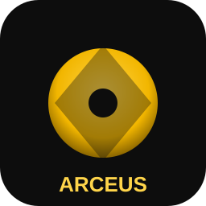

# Arceus AI

A native desktop AI client written in **C++ / Qt 6**. One app, 22 providers out of
the box, a preset system so each chat starts with the right system prompt, an
agentic tool loop (read/write/edit files, run commands) with Claude-style
permission modes, and image generation via Hugging Face.

> Yellow and black. Fast. Local config. No telemetry.



---

## Features

- **22 built-in providers** — OpenAI, Anthropic (Claude), Google Gemini, Groq
  (free), OpenRouter, Together, DeepSeek, Mistral, Fireworks, Perplexity, xAI
  (Grok), Cerebras, SambaNova, GitHub Models, NVIDIA NIM, AI21, Cohere, Hugging
  Face (text + images), plus **Ollama**, **LM Studio**, **llama.cpp** and
  **vLLM** for local models. Add your own via Settings.
- **Presets** — General, Coding, Agentic (Claude-style), Image Generation,
  Research, Brainstorm. Each has its own system prompt, provider, model,
  temperature and tool policy. Fully editable; make your own.
- **Agentic tool loop** — `read_file`, `write_file`, `edit_file`, `list_dir`,
  `run_command`, `generate_image`. Works across the OpenAI, Anthropic and
  Gemini tool-call formats.
- **Permission modes** — `Ask`, `Accept edits`, `Bypass`, `Read-only`. Pick
  per-chat from the header, or set a global default.
- **Chat management** — multi-chat sidebar, rename, delete, right-click menu,
  autosave to a single `arceus.json` under `%APPDATA%/Arceus/Arceus AI/`.
- **Attachments** — paperclip button accepts files; text/code files are inlined
  into the message, binaries are referenced.
- **Streaming** — token-by-token for OpenAI-compatible and Anthropic.
- **Theme** — clean yellow (`#FFD54A`) accent on near-black, markdown rendered
  with syntax-styled code blocks.

---

## Building a real `.exe` on Windows

You need:

1. **Qt 6.5+** (open source install is free): https://www.qt.io/download-qt-installer
   — pick MSVC 2022 64-bit **and** CMake, Ninja, Qt Creator in the installer.
2. **Visual Studio 2022 Build Tools** (C++ workload).
3. The repo cloned somewhere, e.g. `C:\dev\arceus`.

### Easiest path (Qt Creator)
1. Open Qt Creator → *Open Project* → pick `CMakeLists.txt`.
2. Select the MSVC Qt kit.
3. Build → Run. Done.

### CLI path
```powershell
cd C:\dev\arceus
cmake -S . -B build -G "Ninja" -DCMAKE_PREFIX_PATH="C:/Qt/6.7.2/msvc2022_64"
cmake --build build --config Release
```

The output is `build\ArceusAI.exe`. To make it runnable outside the build dir,
ship Qt's runtime next to it:

```powershell
C:\Qt\6.7.2\msvc2022_64\bin\windeployqt.exe build\ArceusAI.exe
```

Zip the resulting folder and that's your installer-free portable app.

### Linux / macOS
Same CMake invocation, with Qt in `CMAKE_PREFIX_PATH`.

---

## Making it feel like yours

### 1. API keys
Settings → *Providers & API keys*. Minimum useful set to get going for free:

| Provider | Why | Where |
|---|---|---|
| Groq | Fast, free Llama 3.3 70B + Qwen Coder | https://console.groq.com |
| OpenRouter | One key routes to Claude/GPT/Gemini + free models | https://openrouter.ai/keys |
| Hugging Face | Free image models (FLUX, SDXL, SD 3.5) | https://huggingface.co/settings/tokens |
| Ollama | Local, no key, no quota | https://ollama.com — then `ollama pull qwen2.5-coder:14b` |

### 2. Replace the icon
Drop a `resources/icon.ico` (256×256 Windows ICO) in and rebuild — the
`.rc` file already picks it up for the taskbar icon. The SVG at
`resources/icon.svg` is used for the in-app window icon.

### 3. Tweak the system prompts
Settings → *Presets* → edit the system prompt. The included "Agentic
(Claude-style)" preset is tuned to actually call the file/command tools; the
"Coding" preset defaults to Qwen Coder on Groq (free) and is good at writing
real code.

### 4. Permission modes
- **Ask**: prompts before every tool call. Safest.
- **Accept edits**: auto-allows file reads/writes, still asks for `run_command`.
- **Bypass**: no prompts. Equivalent to Claude Code's `--dangerously-skip-permissions`.
- **Read-only**: only `read_file` and `list_dir` are allowed.

Set per-chat from the header; set the default in *General*.

---

## Architecture

```
┌─ MainWindow ──────────────────────────────┐
│  Sidebar (ChatList) │ ChatView            │
│  New / Delete / Rename  │ Header (preset, provider, model, perm) │
│                     │ Scrollable messages │
│                     │ Composer + Attach   │
└───────────────────────────────────────────┘
             │
             ▼
┌─ core/Settings ──────────────────────────────────────┐
│  providers[]   presets[]   chats[]   defaults        │
│  persisted to arceus.json                            │
└──────────────────────────────────────────────────────┘
             │
             ▼
┌─ net/ApiRouter ──────────────────────────────────────┐
│  ProviderKind → one of:                              │
│   • OpenAICompatClient  (18 providers)               │
│   • AnthropicClient                                  │
│   • GeminiClient                                     │
│   • HuggingFaceClient   (text + image)               │
│  All emit deltaText / toolCall / imageReady / error  │
└──────────────────────────────────────────────────────┘
             │
             ▼
┌─ core/Tools (ToolRunner) ────────────────────────────┐
│  read_file write_file edit_file list_dir run_command │
│  Gated by PermissionMode + ask-user callback         │
│  Schemas exported in OpenAI / Anthropic / Gemini     │
│  shapes so each provider sees the same tools.        │
└──────────────────────────────────────────────────────┘
```

---

## Keyboard

- **Enter**: send
- **Shift+Enter**: newline
- **Ctrl+N**: new chat
- **Ctrl+Delete**: delete current chat
- **Ctrl+,**: open Settings
- **Ctrl+Q**: quit

---

## Status / honesty

This is a solid foundation, not an industrial product. Things that work today:
chat, streaming, presets, permission-gated tools, 4 provider families (so 22
providers), image gen via HF, config persistence, attachments, delete/rename.

Things you may want to add next:
- Streaming for Gemini and HF (currently non-streaming).
- A proper diff viewer when the agent writes a file.
- Vision input (sending images into chat models that support it).
- A build-in web search tool.
- Encrypted key storage (currently plain JSON — safe enough locally, but
  do not sync the config file).

Pull requests welcome from future-you.
