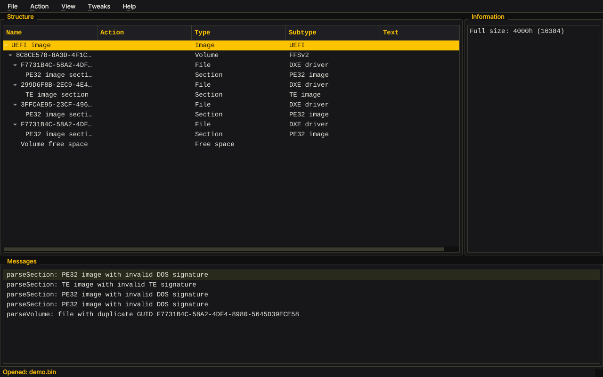
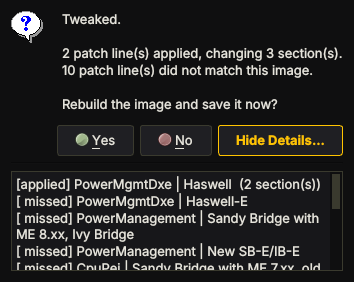
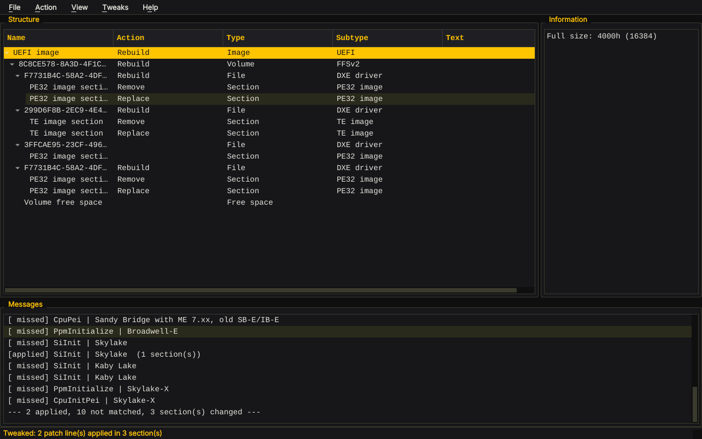

# The UEFITool GUI: theme and presets

Two things were added to the UEFITool window: a yellow on black theme, and a
Tweaks menu that applies groups of patches to the image you have open.

All screenshots here are of the built binary running, driven through the
flow by `tests/screenshot.sh`, not mock-ups.



## The theme

Yellow on near black, applied to the whole application from a single
stylesheet in `UEFITool-0.28.0/theme/dark-yellow.qss`, compiled into the
binary as a Qt resource.

The palette is small on purpose:

| Colour | Used for |
| --- | --- |
| `#0f0f10` | window background |
| `#17171a` | panels, trees, text areas |
| `#1f1f23` | alternating rows, inputs, raised controls |
| `#2a2a1c` | hover |
| `#3a3a2e` | borders |
| `#e6e4dc` | body text |
| `#9a978c` | dimmed text |
| `#ffc400` | the accent: headings, selection, focus |
| `#121212` | text drawn on top of an accent fill |

The accent only ever appears on a near black background, and anything drawn
on an accent fill uses `#121212`, so both directions stay well clear of the
4.5:1 contrast floor. The one place that needed special handling is a ticked
checkbox on a selected row: the row is filled with the accent, so the
indicator inverts there to a dark square instead of disappearing.

**View -> Yellow on black theme** turns it off and back on, with no restart,
and the choice is remembered. Turning it off restores the platform's own
style.

Branch arrows in the structure tree and the drop down arrow in combo boxes
are deliberately left unstyled. Qt draws those from the style, not from
colours, and a stylesheet rule without replacement images renders nothing at
all — an expandable tree with no visible arrows is worse than one that is
slightly inconsistent.

## Presets

**Tweaks -> Performance presets...** (Ctrl+T) opens the preset list. It is
enabled once an image is open.


Presets are grouped by platform, and each one shows its risk and how many
patch lines it carries. Selecting a row fills the pane underneath with the
description, the caveat, and the list of modules the preset touches.

Tick what you want, press **Apply tweaks**, and the patterns are applied to
the open image wherever they match. You then get:

```
Tweaked.

2 patch line(s) applied, changing 3 section(s).
10 patch line(s) did not match this image.

Rebuild the image and save it now?
```



**Show Details** lists every line as applied or missed, and Yes takes you
straight to Save. Saving is what reconstructs the image, so "rebuild and
save" is one step.

A message box's detail pane is a small fixed box, so the same report also
goes to the **Messages** list in the main window, where it is scrollable,
stays put while you work, and the existing *Copy all messages* action can
lift it out. The Action column shows exactly which sections were touched:



In that run the Haswell pattern matched both copies of `PowerMgmtDxe` in the
image, which is what "2 patch line(s) applied, changing 3 section(s)" means
and what **Patch every copy of a module** does.

If nothing matched, it says so plainly and does not pretend the image
changed. That is the normal outcome when a preset is for a different
platform than the image you opened.

**Patch every copy of a module** is on by default. A firmware image often
carries the same module in more than one volume — a recovery copy, or the
same driver in a second firmware volume — and with this on every copy is
patched. Turning it off gives the older behaviour of stopping at the first
match.

**Load preset file...** points the dialog at any file in the preset format,
so patterns you derive yourself appear here without touching the program.

### What is in the preset list

| Group | What is there |
| --- | --- |
| Intel | Two applicable presets: the MSR 0xE2 C-state unlock across Sandy Bridge to Skylake-X, and the combined 0xE2 + 0x1AA unlock for X299, C422 and C620. Plus a note on where the Intel frame rate actually is. |
| AMD | A note, and nothing to apply. |
| Graphics | Two notes, and nothing to apply. |
| Other | The SGX launch control patch and the Z87-Pro pointer fix that upstream shipped. Neither affects performance. |

The AMD and Graphics groups have nothing to click, and the dialog says so
rather than offering a button that would do nothing:

- **AMD.** Upstream UEFITool ships no patch patterns for AMD platform
  firmware, and none were invented here. A byte pattern depends on the
  vendor, the board and often the exact BIOS build, so a made up one either
  matches nothing or matches the wrong thing. It is not much of a loss: the
  AMD levers — Curve Optimizer, PBO limits, EXPO with FCLK:UCLK:MCLK at 1:1,
  Power Supply Idle Control on AM4 — are all settings, not code.
- **Graphics.** Resizable BAR is a real frame rate win, but it is a setup
  setting (with Above 4G Decoding on and CSM off), not a pattern. A graphics
  card's own VBIOS is not an FFS image at all, so UEFITool cannot parse or
  patch it, and the GOP driver that does live in system firmware stops
  running the moment the OS loads its graphics driver.

Both notes point at the route that does work: write the NVRAM variable
directly, which needs no reflash and no modified image. See
[bios-performance-guide.md](bios-performance-guide.md).

To add your own, derive the pattern with `tools/msr-lock-scan.py` and
[pattern-cookbook.md](pattern-cookbook.md), then add a set to
`patches/presets.txt`:

```
#!platform AMD
#!set amd-my-board-unlock
#!desc What it does, as it should read in the list
#!risk medium
#!note Derived from my own dump, confirmed in a disassembler.

# ModuleName | board and BIOS version
<guid> 10 P:<find>:<replace>
```

It shows up in the dialog the next time you open it, under that platform
heading.

## Screenshots

`tests/screenshot.sh` builds UEFITool, starts a virtual X server, runs the
real binary under it and clicks through the whole preset flow with xdotool,
writing the four images in this document to `docs/images/`. It needs

```sh
apt-get install xvfb openbox xdotool x11-utils imagemagick
```

on top of Qt. The dialog is driven from the keyboard where it can be, because
pixel coordinates depend on how the preset names happen to wrap.

## Testing

`tests/run_gui_tests.sh` builds `tests/guicheck`, which links the same
sources as UEFITool with its own `main()`, and runs 53 checks under Qt's
offscreen platform plugin — no X server, no real firmware. It covers the
theme resource and the toggle, the menu layout, that presets stay disabled
until an image is open, that the catalog groups by platform, that exactly
the applicable presets are tickable, and that ticking one reports it as
selected. It also renders both screenshots above.

The last check is the useful one: it runs the same apply sequence the GUI
performs, writes the result, and diffs it against the image UEFIPatch
produces from the same preset on the command line. Both go through
`applyPatchEntry()` in `patchset.cpp`, and the test fails if they ever stop
agreeing byte for byte.

Its own renders are written as `offscreen-*.png` so they can never be
confused with, or overwrite, the pictures of the real binary that
`screenshot.sh` produces.
