# A real BIOS, start to finish

Every picture here is the built binary running against a real 16 MB firmware
image — an MSI B550 dump, `B55MAE13.FB` — not the synthetic test fixture.
Nothing was staged: where the tool found nothing to do, that is in the
screenshots too.

## 1. Open it

The scan runs on open and the result goes straight to the Messages list.

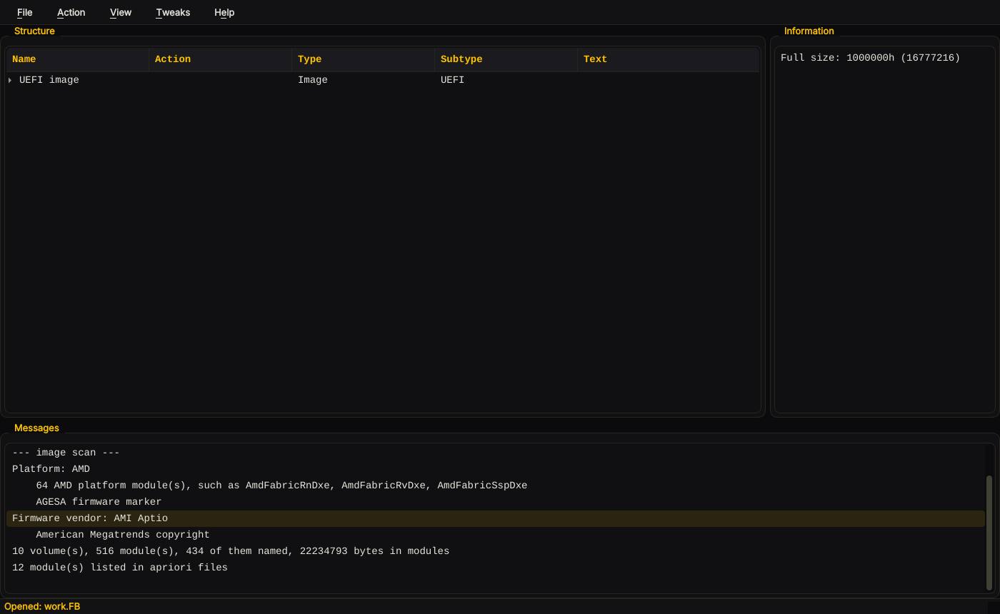

```
Platform: AMD
    64 AMD platform module(s), such as AmdFabricRnDxe, AmdFabricRvDxe, AmdFabricSspDxe
    AGESA firmware marker
Firmware vendor: AMI Aptio
    American Megatrends copyright
10 volume(s), 516 module(s), 434 of them named, 22234793 bytes in modules
12 module(s) listed in apriori files
```

All of that is read out of the file: the AMD verdict from 64 modules whose
names start `AmdFabric`, `AmdCcx`, `AmdPsp` and so on plus the `AGESA`
marker, and AMI Aptio from the American Megatrends copyright string.

One bug got fixed getting here. The first run on this image came back
*"ambiguous, evidence for both Intel and AMD"*, because the Intel hint
`MeSmm` matches as a substring inside `RuntimeSmm` and `NvmeSmm` — two
perfectly ordinary modules on an AMD board. Hints are matched as name
prefixes now, and a lopsided split resolves to the majority instead of
shrugging.

## 2. The menu

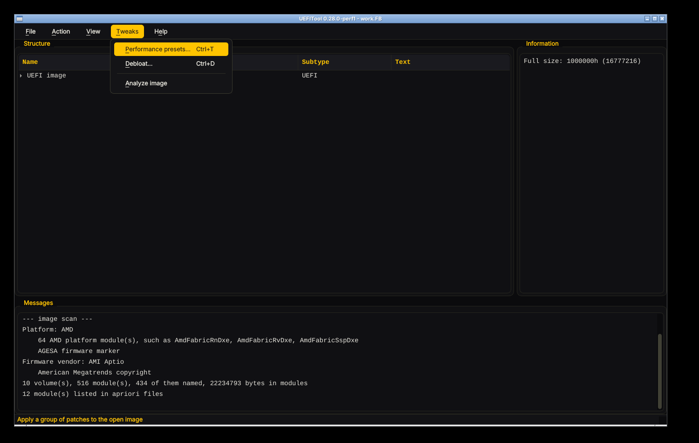

## 3. Analyze

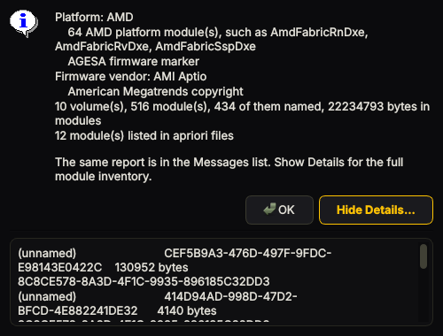

The same report, with the full module inventory behind **Show Details**.

## 4. Tweaks, on a board none of them fit

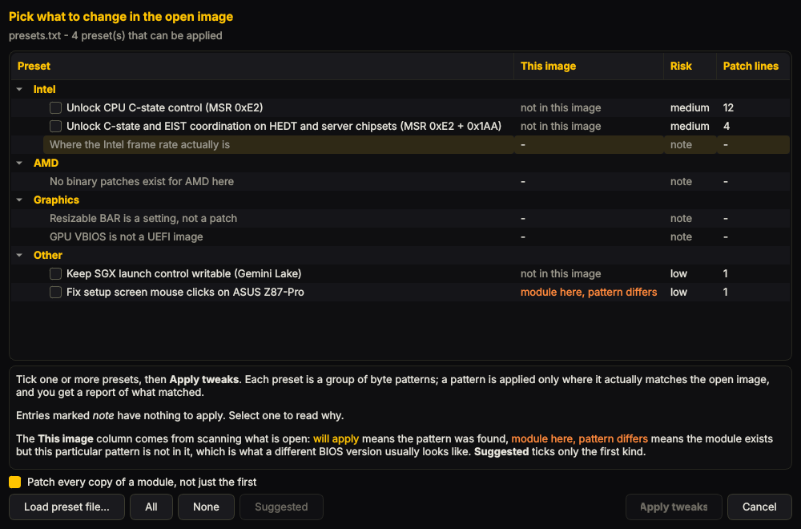

This is the honest half of the exercise. Every Intel preset reads **not in
this image**. The one amber row is the ASUS Z87-Pro USB fix: that GUID is a
standard USB host controller, so the module *is* here, but the byte pattern
is not — which is exactly what **module here, pattern differs** means.

**Suggested** is greyed out, because there is nothing to suggest.

Tick one anyway and the tool says so plainly rather than writing a file and
reporting success:

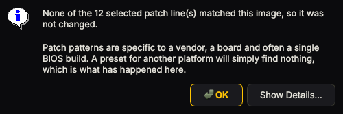

Upstream UEFIPatch is where this matters: a run where some lines match and
the one you needed does not prints `Image patched` and exits 0.

## 5. Debloat

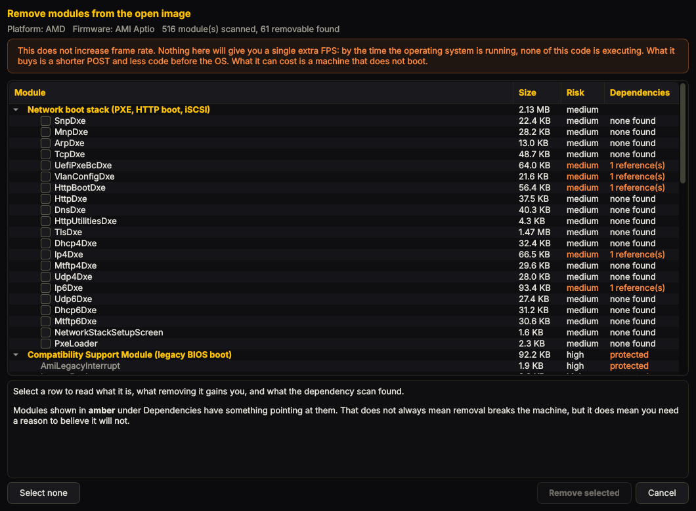

**516 modules scanned, 61 removable found.** The network boot stack alone is
**2.13 MB** across 18 modules, with `TlsDxe` at 1.47 MB of it. Amber under
Dependencies means another module carries that one's GUID.

Scrolling down is where the protection shows:

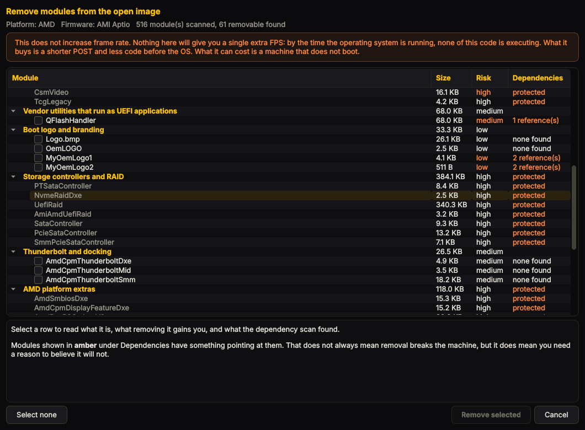

`CsmVideo`, `TcgLegacy`, every storage and RAID driver, and the AMD platform
extras are listed with **protected** and **no checkbox**. They are shown so
you can see what your image contains; the tool will not remove them. CSM
sits on the boot path, a storage driver may be the only way to reach your
boot disk, and the flash write path is how the board recovers — none of that
belongs behind a checkbox.

Three safe things picked, all with nothing pointing at them:

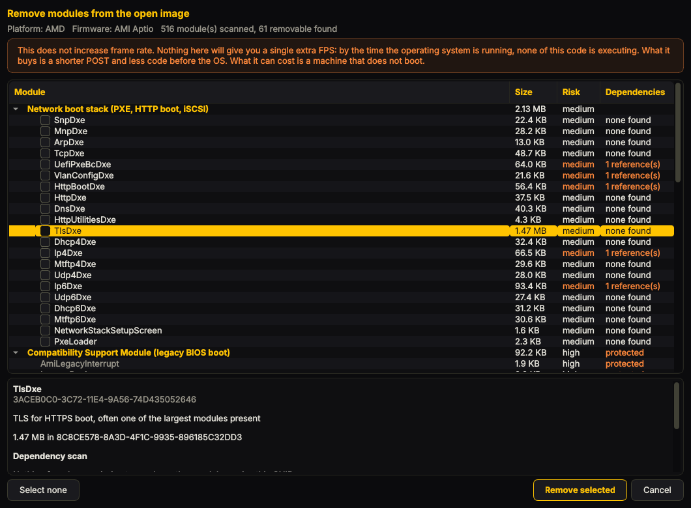

## 6. Confirm, remove, rebuild

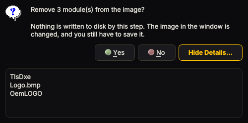

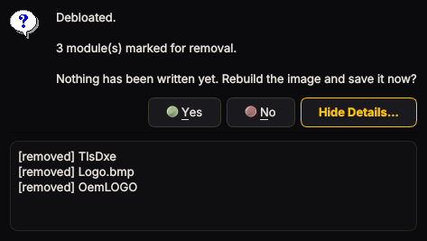

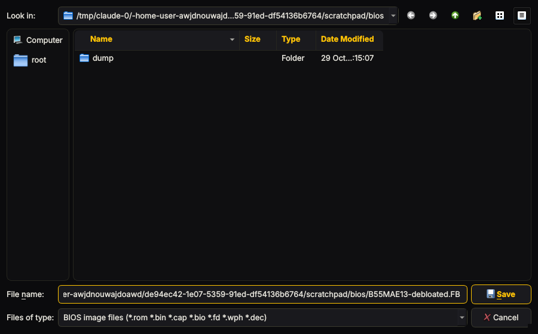


## 7. Reopen the result

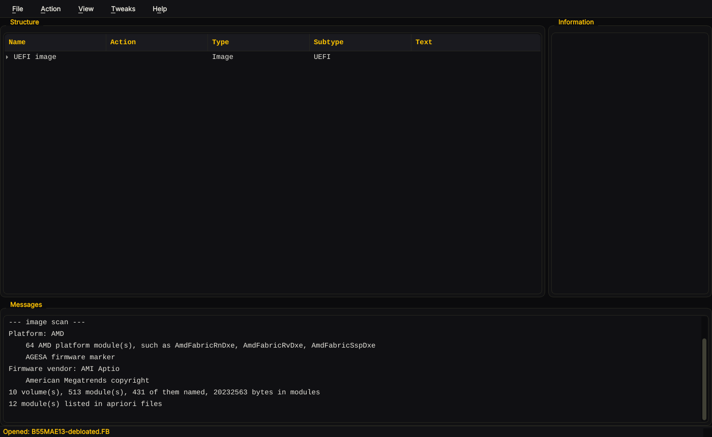

```
before   10 volume(s), 516 module(s), 434 named, 22234793 bytes in modules
after    10 volume(s), 513 module(s), 431 named, 20232563 bytes in modules
```

Verified again from the command line, against both files:

```
$ UEFIPatch B55MAE13.FB -a -v          > before.txt
$ UEFIPatch B55MAE13-debloated.FB -a -v > after.txt
removed:
  -Logo.bmp
  -OemLOGO
  -TlsDxe
added:
```

Exactly the three modules that were ticked, nothing else touched, nothing
added. The output is still 16777216 bytes, which is correct: a firmware
image has to stay the size of the flash chip, so freed space becomes free
space rather than a smaller file. It re-parses with no structural errors and
the platform and vendor detection still work on it.

## What this does not tell you

The image was never flashed, and this project has no way to flash it. A
rebuilt image that parses cleanly is not the same as one that boots:

- **This is an AM4 board, so AMD Platform Secure Boot may well reject a
  modified image outright.** Check before you plan to flash anything.
  [risks-and-recovery.md](risks-and-recovery.md) covers it.
- Removing `TlsDxe` removes HTTPS boot. Removing the logos means POST draws
  something else, or nothing.
- The dependency scan found nothing against those three. As the dialog says
  on every clean result, that means nothing was found against them, not that
  removing them is safe.

## And on tweaks for this board

There are none, and the screenshots show it. Chasing it properly:

```
$ UEFIPatch B55MAE13.FB --dump out/
Dumped 1802 section body(s) to out/
$ tools/msr-lock-scan.py --summary out/*.bin
1789 file(s), 2322 rdmsr/wrmsr site(s), 1338 attributed, 984 not

  0xc0010015  x63    HWCR - hardware configuration, CpbDis in bit 25 disables core boost
               in AmdCcxVhSmm_79DE6AEF-...
               in AmdCcxZen3Smm_61631080-...
  0xc0010064  x36    P-state 0 definition, the top P-state's ratio and voltage
               in AmdCcxVhSmm_79DE6AEF-...
               in CbsSetupDxeRN_F27F4D0C-...
```

So this firmware's boost and P-state control lives in `AmdCcx*Dxe/Smm` and
`CbsSetupDxe*`, which is where you would expect it. What is *not* there is
anything resembling Intel's `CFG_LOCK`: AMD has no MSR 0xE2, and there is no
established lock-removal patch for these registers. Writing one blind, from
a byte scan, with no board to test on, would be inventing a patch and
calling it knowledge. So there is no AMD preset, and the dialog says why.

The AMD levers are settings — Curve Optimizer, PBO limits, EXPO with
FCLK:UCLK:MCLK at 1:1 — and this image has `CbsSetupDxe*` modules, which is
where AMD CBS hides them. [bios-performance-guide.md](bios-performance-guide.md)
covers reaching those without modifying the image at all.

One more thing that run taught the tool. Scanning the **raw** 16 MB dump
finds 400 rdmsr/wrmsr byte pairs and attributes 40 of them, to numbers like
`0xB2B400E1` — noise, because the module bodies are compressed inside their
volumes. Scanning the **extracted** modules finds 2322 sites and attributes
1338, to real MSRs in the modules that should have them. `--summary` now
says so when the ratio looks wrong:

```
Most sites could not be attributed to an MSR. That usually means
these are compressed or packed bytes rather than code. Extract the
modules first: UEFIPatch <image> --dump <dir>
```
